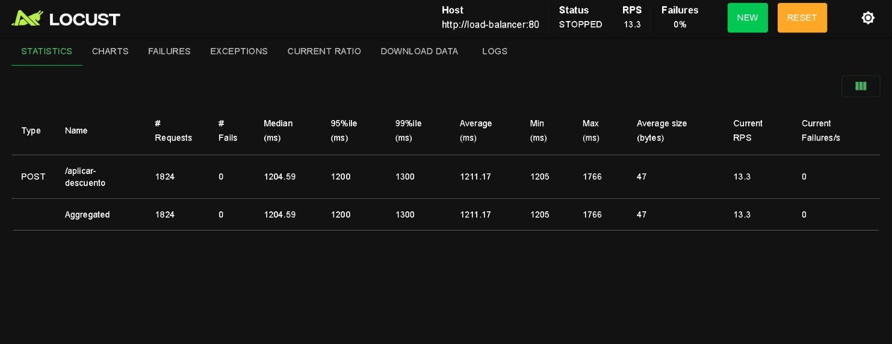
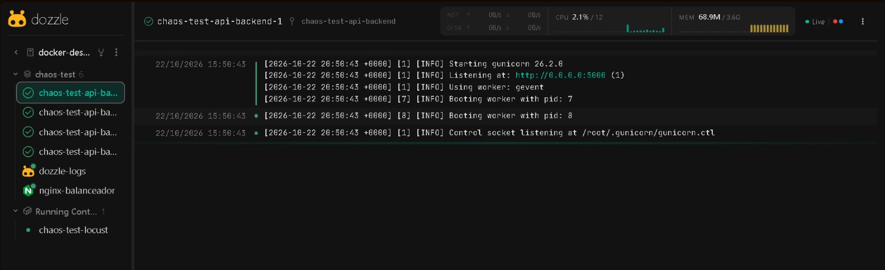

# Análisis del fallo en cascada y solución del clúster

**Fecha:** 22 de Octubre de 2026\
**Rol:** SRE (Site Reliability Engineer)  
**Servicio Afectado:** Endpoint POST `/aplicar-descuento`  
**Equipo de trabajo:**

- Juan Esteban Robledo Forero
- Diego Fernando Castillo Cruz
- Juan David Casanova Melo
- Nicolas Steven Prieto Gomez

---

## 1. ¿Por qué falla el healthcheck si la ruta `/health` responde rápido?

Aunque la ruta `/health` solo devuelve un mensaje `"OK"`, necesita que Gunicorn tenga disponibilidad para atenderla. El problema aparece cuando llegan muchas solicitudes a `/aplicar-descuento`, porque cada una tarda 1,2 segundos en responder.

Como Gunicorn tiene dos trabajadores y los recursos de CPU son limitados, puede pasar que los dos estén ocupados atendiendo solicitudes y la comprobación de salud tenga que esperar. Si no recibe respuesta dentro del tiempo establecido, Docker puede marcar el contenedor como `unhealthy`, aunque el problema no esté directamente en la ruta `/health`.

## 2. ¿Qué pasa cuando una réplica se reinicia?

Cuando una réplica deja de responder, las solicitudes que estaba atendiendo pueden fallar o interrumpirse. Nginx intenta enviar las nuevas peticiones a otras réplicas según su configuración. Si las demás también están ocupadas, pueden empezar a aparecer errores 502 o 503.

Esto puede generar una reacción en cadena porque, al perder una réplica, las demás reciben más trabajo. Si no tienen capacidad suficiente para atender todas las solicitudes, también pueden demorarse y fallar las comprobaciones de salud.

De esta manera, un problema que comienza en una sola réplica puede afectar a todo el servicio. Sin embargo, esto depende de la carga y de la configuración del sistema; no siempre ocurre automáticamente.

## 3. ¿Qué solución aplicamos sin aumentar la CPU?

### Ajuste de Gunicorn

Cambiamos la configuración de Gunicorn para utilizar trabajadores `gevent`, manteniendo dos trabajadores por proceso:

`-k gevent -w 2`

Elegimos esta configuración porque permite atender varias solicitudes al mismo tiempo, especialmente cuando algunas deben esperar antes de responder. Así se aprovecha mejor el tiempo de los trabajadores y se evita que una espera bloquee completamente la atención de otras solicitudes.

### Ajuste del healthcheck

También modificamos los tiempos de comprobación en Docker Compose:

- **Intervalo de 10 segundos:** para realizar las comprobaciones cada 10 segundos.
- **Timeout de 3 segundos:** para permitir más tiempo a que el servicio responda.
- **Tres reintentos:** para evitar que un solo fallo temporal marque inmediatamente el contenedor como no saludable.
- **Periodo inicial de 15 segundos:** para darle tiempo al servicio de arrancar correctamente.

Con estos cambios, el sistema tolera mejor las demoras temporales y disminuye la posibilidad de que una réplica sea marcada como no saludable solo porque está ocupada.

### Resultados obtenidos

Después de realizar los cambios, ejecutamos la prueba de carga con Locust y obtuvimos los siguientes resultados:

- Se procesaron **1.824 solicitudes** a `/aplicar-descuento`.
- Se registraron **0 errores**, equivalente a un 0 % de fallos.
- El tiempo promedio de respuesta fue de **1.211,17 milisegundos**.

- Los cuatro contenedores del backend aparecieron en estado `healthy`.
- Nginx permaneció activo durante la comprobación.

### Conclusión

Con esta práctica entendimos que el problema no era que la ruta `/health` estuviera mal hecha, sino que podía quedarse esperando cuando los trabajadores estaban ocupados atendiendo otras solicitudes. Por eso, ajustamos Gunicorn para manejar mejor las peticiones concurrentes y aumentamos los tiempos de tolerancia del healthcheck.

Los resultados muestran que, con esta configuración y durante la prueba realizada, el sistema pudo atender más de 500 solicitudes sin registrar fallos y mantener las cuatro réplicas saludables, sin aumentar los recursos de CPU.
