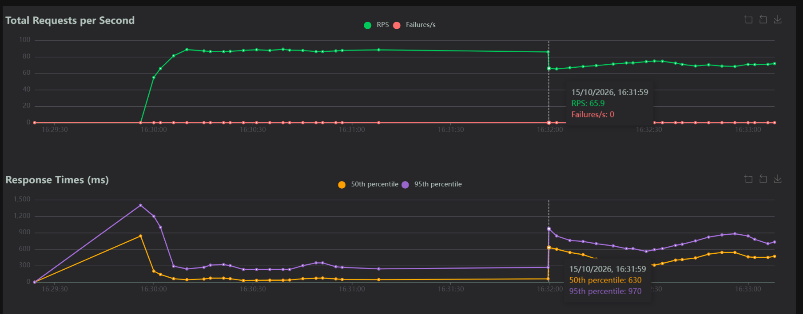

# Informe de Rendimiento: Resiliencia, Pruebas de Carga y Chaos Engineering

**Integrantes del equipo:**

- Juan Esteban Robledo Forero
- Nicolas Steven Prieto Gomez
- Juan David Casanova Melo
- Diego Fernando Castillo Cruz

---

## 1. Tabla Comparativa de Resultados

| Fase       | Servidor / Arquitectura | Límite CPU | Usuarios Concurrentes | RPS Logrados | Latencia P95 (ms) | % Errores |
| :--------- | :---------------------- | :--------- | :-------------------- | :----------- | :---------------- | :-------- |
| **Fase 1** | Flask Dev (`app.run`)   | 0.10 Cores | 50                    | 14.9 RPS     | 2100 ms           | 0%        |
| **Fase 2** | Gunicorn (4 workers)    | 0.10 Cores | 50                    | 29.4 RPS     | 200 ms            | 0%        |
| **Fase 3** | Nginx + 3 Réplicas      | 0.10 c/u   | 150                   | 85.9 RPS     | 270 ms            | 0%        |

---

## 2. Capturas de Pantalla y Evidencia

### Caída de Réplica en Vivo (Chaos Test - Fase 3)

_Esta gráfica muestra el momento justo en el que la replica fue detenida y muestra como las Requests Per Second (RPS) y el 95 percentil (95th percentile) tuvieron un golpe fuerte pero despues de un tiempo, lograron recuperarse._

---

## 3. Análisis Técnico

### ¿Por qué un servidor multiproceso con balanceador de carga logra responder más tráfico usando las mismas restricciones de hardware que un servidor uniproceso?

Un servidor multiproceso con balanceador de carga es capaz de procesar y absorber una cantidad significativamente mayor de tráfico bajo las mismas restricciones de hardware que un servidor uniproceso gracias a la distribución concurrente y al aprovechamiento del paralelismo de I/O. En la Fase 1, un entorno uniproceso (como el servidor de desarrollo de Flask) procesa las solicitudes de forma secuencial o bloqueante, lo que provoca que un pico de peticiones sature el único núcleo asignado y genere cuellos de botella y timeouts. En contraste, al implementar Gunicorn con múltiples trabajadores (Fase 2) y un clúster distribuido gestionado por Nginx (Fase 3), las peticiones se reparten de manera equitativa entre múltiples procesos independientes que atienden solicitudes en paralelo, optimizando el uso de los hilos del procesador.

Asimismo, la arquitectura distribuida con Nginx y réplicas aporta una alta tolerancia a fallos y resiliencia ante pruebas de caos (Chaos Test). Cuando una de las réplicas se apaga abruptamente, Nginx detecta la caída a través de su algoritmo de enrutamiento y redirige de forma transparente el tráfico entrante hacia las réplicas sobrevivientes. Esto evita que el sistema colapse por completo, reduciendo al mínimo la tasa de errores HTTP 500 y permitiendo que la aplicación mantenga su disponibilidad operativa y un rendimiento estable a pesar de la pérdida parcial de infraestructura.
