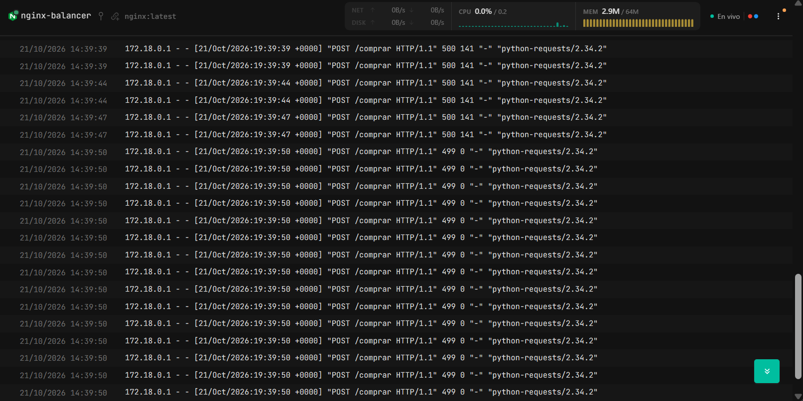
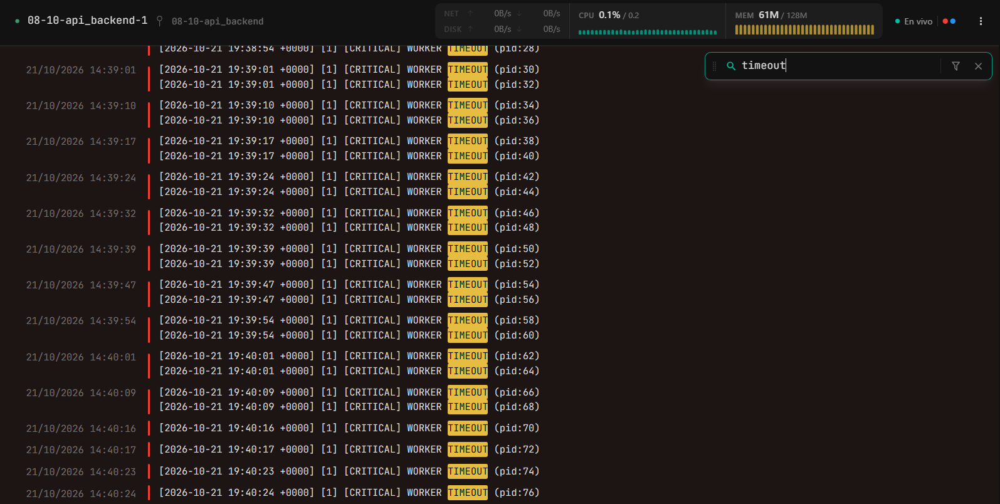
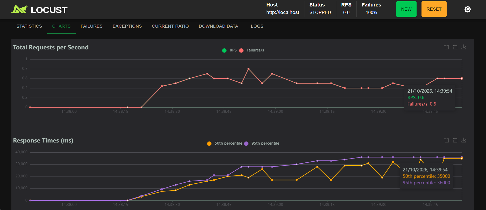

# Reporte SRE Post-Mortem

**Fecha:** 21 de Octubre de 2026\
**Rol:** SRE (Site Reliability Engineer)  
**Servicio Afectado:** Endpoint POST `/comprar`  
**Equipo de trabajo:**

- Juan Esteban Robledo Forero
- Diego Fernando Castillo Cruz
- Juan David Casanova Melo
- Nicolas Steven Prieto Gomez

---

## 1. Identificación del Síntoma

### Comportamiento Observado

- **Código de Estado HTTP en Nginx (`nginx-balanceador`):**
  - `500 Server Error`
  - `499 Client Closed Request`
- **Mensaje de Error en el Backend (`api-backend`):**

```text
[2026-10-21 19:40:24 +0000] [1] [CRITICAL] WORKER TIMEOUT (pid:76)
[2026-10-21 19:40:25 +0000] [1] [ERROR] Worker (pid:76) was sent SIGKILL! Perhaps out of memory?
```

**Conclusión:**  
Nginx nos devolvio el error `500 Server Error`, lo que nos indica que lo que esta sucediendo es algo interno de nuestra aplicación/servidor.

Por otro lado, Dozzle nos muestra que en el `api-backend` los workers estan teniendo Timeouts:

```text
   [1] [CRITICAL] WORKER TIMEOUT (pid:76)
```

Y al mismo tiempo, estan siendo terminados porque el proceso se encuentra congelado:

```text
[1] [ERROR] Worker (pid:76) was sent SIGKILL! Perhaps out of memory?
```

Lo que nos indica que lo que esta sucediendo es que hay un error directamente en la ejecución de la tarea, lo cual no permite que el worker pueda completar su task, y que despues de esto termine teniendo un Timeout y el ambiente lo termine por estar congelado.

---

## 2. Diagnóstico de la Causa Raíz (Análisis SRE)

**Análisis:**  
La razón principal por la que Gunicorn esta matando los procesos de los workers es por sus Timeouts, y para poder liberar memoria.

Esto esta relacionado con `time.sleep(4)` y `-t 3` de manera muy cercana, esto gracias a que le estamos diciendo a la acción que espere 4 segundos antes de ejecutarse, pero tambien le estamos diciendo a Gunicorn que el tiempo máximo de timeout son 3 segundos.

Al final, la tarea se demora más tiempo del que Gunicorn le permine al worker para ejecutar su acción, haciendo que al final termine generando una excepción `SystemExit: 1`.

---

## 3. Efecto Dominó en la Arquitectura

**Comportamiento bajo carga:**  
_(Describe qué sucede con los 15 usuarios concurrentes de Locust cuando las 2 réplicas de la API (2 workers por réplica = 4 slots en total) se saturan. Explica cómo interpreta Nginx esta falta de respuesta)._
Tenemos 2 replicas, cada una con 2 workers, haciendo que tengamos, en total, 4 workers que pueden procesar 4 peticiones concurrentes.

Al hacer la prueba con Locust, estamos haciendo una prueba de carga de 15 usuarios concurrentes, todos atacando al mismo endpoint `/comprar`, los 4 workers del contenedor inmediatamente se saturan, haciendo que las otras 11 peticiones se acumulen en espera.

Tambien tenemos que tener en cuenta que estamos introduciendo una espera de 4 segundos en cada petición (`time.sleep(4)`), lo que al final hace que los workers se bloqueen, superen el tiempo máximo de timeout que Gunicorn tiene configurado (`-t 3`).

Esto termina generando un efecto dominó bastante claro: los trabajadores se eliminan y se reinician forzosamente, quedandose sin hilos disponibles para responder a los demás usuarios, al pasar esto, Nginx intenta encontrar contenedores listos para procesar, pero no encuentra ninguno, y registra códigos de error (`500` y `499`), esto mientras el usuario experimenta bloqueos o un error.

---

## 4. Propuesta de Solución

**Ajuste de Configuración de Gunicorn:**  
 Ajustar el parametro timeout `-t` dado en la configuración de Gunicorn de `-t 3` a `-t 6` o `-t 8` para darle al programa tiempo para procesar las peticiones.

Tambien se podría aumentar la cantidad de workers de 2 a 3 para que se puedan procesar más peticiones y evitar que el contenedor se sature.

---

## 5. Evidencia Fotográfica

### Evidencia 1: Estado HTTP de Nginx (`HTTP 500 y HTTP 499`)



### Evidencia 2: Evento de Error en Dozzle (`WORKER TIMEOUT`)



### Evidencia 3: Gráfico de Latencia y Fallas en Locust


